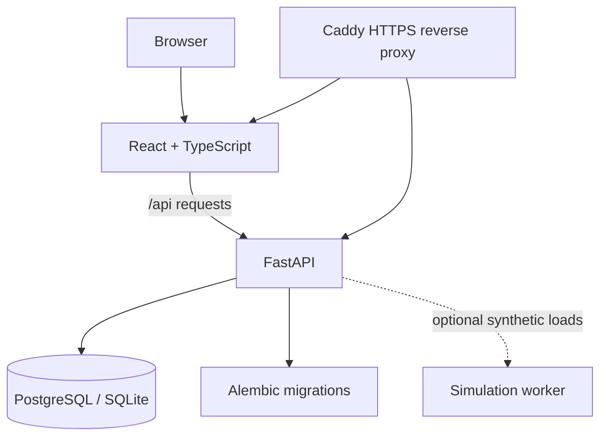

<!--
SmartVolt — public project README
Keep this file focused on product value, reproducible setup, and honest limitations.
-->

<div align="center">

# ⚡ SmartVolt

### A clearer way to explore prepaid energy, shared meters, and simulated consumption.

**SmartVolt** is a full-stack web application for modelling prepaid electricity meters in hostels and shared accommodation—rooms, tenants, wallets, usage, and support—in one interactive workspace.

[](https://github.com/Er-Ishan-Srivastav/SmartVolt/actions/workflows/ci.yml)
[](https://github.com/Er-Ishan-Srivastav/SmartVolt/actions/workflows/frontend.yml)
[](https://www.python.org/)
[](https://fastapi.tiangolo.com/)
[](https://react.dev/)
[](https://www.typescriptlang.org/)
[](LICENSE)

**[🌐 Open the live demo](https://smartvolt-demo.duckdns.org/overview)** · **[API docs](https://smartvolt-demo.duckdns.org/docs)** · **[Report a bug](https://github.com/Er-Ishan-Srivastav/SmartVolt/issues/new?template=bug_report.md)**

<sub>Simulation and learning project · No physical meter or real payment processing required</sub>

</div>

---

## ✨ What is SmartVolt?

Shared accommodation often means shared electricity usage, a prepaid balance, and questions about who used what and when. SmartVolt provides a sandbox for exploring those workflows without connecting to electrical hardware or moving real money.

The project combines a responsive React workspace with a FastAPI backend, a relational data model, auditable wallet movements, and configurable load simulation. It can run locally for development or as a Docker Compose deployment behind Caddy HTTPS.

## 🚀 Explore the workspace

| Area | What you can do |
|---|---|
| **Overview** | Review meter balance, current status, recent activity, and consumption summaries. |
| **Usage & analytics** | Explore daily and hourly reports, compare energy and cost, and inspect historical readings. |
| **Transactions** | Review simulated recharges, statuses, and transaction history. |
| **Rooms & tenants** | Manage room/meter relationships, tenant accounts, room lifecycle, and meter-specific details. |
| **Admin Console** | Create and manage rooms and tenants, operate across meters, and handle support workflows. |
| **Load Lab** | Control appliance quantities, schedule daily load templates, run scenarios, and explore estimated energy and cost. |
| **Help & support** | Create room-wide or private tickets and continue conversations in a threaded timeline. |
| **Exports** | Download meter-scoped CSV usage and print a monthly statement for review. |

### 🔌 Load Lab: control the load, not just the switch

The simulation lab supports per-appliance quantities so a scenario can represent several devices of the same type.

- **Live Appliance Board:** select 1–100 units per appliance, switch the load on, and update the quantity of a running appliance.
- **Personal daily templates:** define quantity, start time to the minute, and runtime in 15-minute increments for each appliance row.
- **Energy and cost preview:** estimate daily kWh and cost using the selected meter's tariff before applying a template.
- **Midnight-aware schedules:** a schedule that crosses midnight is split across the day boundary.
- **Legacy template compatibility:** older templates without quantity data default to one unit per listed appliance.
- **Historical scenarios:** backfill earlier dates without debiting the current wallet; applying a current-day scenario can consume prepaid balance.

For the details and rollout notes, see [Load Lab quantity controls](docs/LOAD_LAB_QUANTITY_CONTROLS.md).

## 🧭 How it fits together



In production, Caddy terminates HTTPS and routes API/documentation traffic to FastAPI and the remaining requests to the static frontend. PostgreSQL and FastAPI ports are not published publicly by the production Compose configuration. The synthetic consumption worker is opt-in because it can create readings and deduct simulated balances.

## 🧰 Technology

| Layer | Technologies |
|---|---|
| Frontend | React 18, TypeScript, Vite, Recharts, Lucide |
| API | Python 3.11+, FastAPI, Pydantic |
| Persistence | SQLAlchemy 2.x, PostgreSQL 16, SQLite for lightweight local development |
| Schema management | Alembic migrations |
| Tests & quality | pytest, HTTPX, Ruff, GitHub Actions |
| Deployment | Docker Compose, Nginx, Caddy automatic HTTPS |

## ⚡ Run it locally

### Option A — Docker Compose (recommended)

**Requirements:** Docker Desktop (Windows/macOS) or Docker Engine + the Compose plugin (Linux).

From the repository root:

```bash
docker compose up --build -d
docker compose exec api python -m app.db.seed
docker compose ps
```

Open the app at **http://localhost:5173**. The API health endpoint is **http://localhost:8000/api/v1/health**, and interactive API documentation is **http://localhost:8000/docs**.

Useful commands:

```bash
# Follow application logs
docker compose logs -f api frontend

# Stop containers while retaining the database volume
docker compose down

# Apply migrations after updating the source
docker compose exec api alembic upgrade head
```

> **Data warning:** `docker compose down` preserves the named database volume. Do not add `-v` unless you intentionally want to delete the local database data.

The default development Compose credentials and demo seed are for local use only. Do not reuse them on a public server.

### Option B — Python API + Vite frontend

**Requirements:** Python 3.11 or later and Node.js (the frontend lockfile is in `frontend/`).

Create a virtual environment and install the API plus development dependencies.

**Windows PowerShell**

```powershell
py -3.11 -m venv .venv
.\.venv\Scripts\Activate.ps1
python -m pip install --upgrade pip
pip install -e ".[dev]"
Copy-Item .env.example .env
alembic upgrade head
python -m app.db.seed
uvicorn app.main:app --reload
```

**macOS / Linux / Git Bash**

```bash
python3 -m venv .venv
source .venv/bin/activate
python -m pip install --upgrade pip
pip install -e ".[dev]"
cp .env.example .env
alembic upgrade head
python -m app.db.seed
uvicorn app.main:app --reload
```

In a second terminal:

```bash
cd frontend
npm ci
npm run dev
```

Open **http://localhost:5173**. Vite forwards `/api` requests to the FastAPI service at `http://127.0.0.1:8000`.

The local seed creates demo data for development. Treat all seeded identities and balances as disposable test data; never use local demo passwords or the sample `AUTH_SECRET` in a deployment.

## 🐳 Production deployment

The production path uses `docker-compose.prod.yml`, a static frontend build, FastAPI, PostgreSQL, and Caddy for automatic HTTPS.

1. Copy `.env.production.example` to `.env.production`.
2. Set `SMARTVOLT_DOMAIN` to a real DNS hostname pointing to the server.
3. Generate unique values for `POSTGRES_PASSWORD` and `AUTH_SECRET`; choose a strong, unique `ADMIN_PASSWORD`.
4. Validate and start the stack:

   ```bash
   docker compose --env-file .env.production -f docker-compose.prod.yml config --quiet
   docker compose --env-file .env.production -f docker-compose.prod.yml up --build -d
   ```

5. Bootstrap the first administrator on a new production database:

   ```bash
   docker compose --env-file .env.production -f docker-compose.prod.yml exec api python -m app.db.bootstrap_admin
   ```

6. Verify service health and Caddy certificate issuance before sharing the URL.

Read the full [Docker + HTTPS deployment guide](docs/DOCKER_DEPLOYMENT.md) and [security notes](SECURITY.md) first. **Never commit `.env.production`, private keys, database dumps, or real resident data.** Keep inbound access to SSH restricted to your IP; do not expose PostgreSQL (5432) or FastAPI (8000) directly to the internet.

## 📊 Analytics and billing semantics

- Hourly reports use **Asia/Kolkata** day boundaries and 24 hourly buckets.
- Historical block-based readings that cannot be attributed reliably to an hour are labelled as coarse/unallocated instead of being assigned a misleading timestamp.
- CSV exports are meter-scoped and use inclusive IST date ranges (up to 366 days).
- Monthly statements are printable summaries, not tax invoices or proof of real utility-payment processing.
- Environmental values are estimates. The default grid factor is configurable with `GRID_CO2_FACTOR_KG_PER_KWH`; the tree-year equivalent is an educational assumption configured by `TREE_CO2_ABSORPTION_KG_PER_YEAR`. Review the source and current factor before using estimates in formal reporting.

## 🧪 Tests and checks

From the repository root:

```bash
python -m pip install -e ".[dev]"
python -m pytest -q
python -m ruff check .
cd frontend
npm ci
npm run build
```

CI runs the backend test and lint workflow; the frontend has its own GitHub Actions workflow. Review the Actions tab for the latest results rather than relying on a static status claim.

## 🗂️ Project map

```text
SmartVolt/
├── app/                     # FastAPI routes, models, schemas and services
├── alembic/                 # Versioned database migrations
├── frontend/                # React + TypeScript + Vite application
├── tests/                   # API and bootstrap tests
├── docs/                    # API, data model, deployment and Load Lab docs
├── docker-compose.yml        # Local development stack
├── docker-compose.prod.yml  # Production stack with Caddy HTTPS
├── Caddyfile                # HTTPS routing and security headers
├── Dockerfile.prod          # Production API image
└── pyproject.toml            # Python dependencies and test/lint settings
```

## 🛡️ Scope and limitations

SmartVolt is a **simulation and learning project**, not a certified electricity meter or financial service.

- It does not control physical electrical relays or read real IoT hardware.
- Recharges are simulated; no payment provider or real money movement is configured.
- Shared-meter consumption is not a measurement of each roommate's individual usage.
- Synthetic telemetry can debit simulated wallets. Keep the worker disabled unless you deliberately want that behavior.
- Before allowing untrusted public users, perform a security review, test authorization and PostgreSQL concurrency, add abuse protection/rate limiting, and establish verified off-instance backups and monitoring.

See [SECURITY.md](SECURITY.md), [the API reference](docs/API.md), [the data model](docs/DATA_MODEL.md), and the [roadmap](docs/ROADMAP.md).

## 🤝 Contributing

Bug reports and focused improvements are welcome. Please:

1. Open an issue describing the behavior or proposed change.
2. Keep schema changes in Alembic migrations.
3. Add or update tests for backend behavior.
4. Run the backend checks and frontend production build.
5. Open a pull request with a concise description and verification notes.

See [CONTRIBUTING.md](CONTRIBUTING.md) and the [team workflow](docs/TEAM_WORKFLOW.md).

## 📄 License

Released under the [MIT License](LICENSE).
