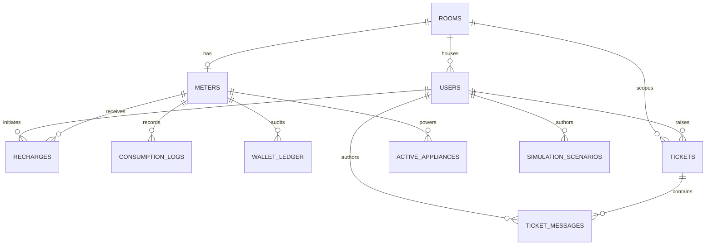

# Data Model Notes

## Entity relationships



- One room has at most one meter in this initial model; `meters.room_id` is unique.
- Each resident has at most one current room assignment; a room can have multiple active resident accounts. All residents in a room share that room's single meter. Users can recharge only that assigned room's meter; the service rejects a user-room mismatch.
- `consumption_logs` captures the measured/simulated units, charged cost and post-debit balance for each reading.
- `recharges` stores top-ups, permanent `RCH-...` references, optional tenant context (`user_id`), authenticated transaction actor (`actor_user_id`), and a unique idempotency key to prevent duplicate credits.
- `wallet_ledger` is an audit trail: positive `amount` means credit, negative `amount` means consumption debit. `balance_after` makes individual entries easier to reconcile. `actor_user_id` records who performed a new transaction independently from optional tenant context; historical actor attribution remains unknown when it cannot be proven.
- Admin recharges always resolve to a canonical active meter. Room number/code and tenant ID/code/username are only selectors; the wallet balance belongs to the meter.
- `tickets` stores permanent `TKT-...` references, requester, original room association and room label snapshots, visibility (`ROOM` or `PRIVATE`), priority, workflow status and timestamps. Room-wide visibility is checked against current room membership; the requester can still access their own ticket after moving rooms. Private tickets are requester/admin-only. Existing roomless tickets are backfilled as private.
- `ticket_messages` stores the append-only support conversation, including author ID when available plus author-name/role snapshots. Migration 0006 copies each existing ticket description into the initial timeline message so no original content is lost. Residents can reply to visible non-closed tickets; administrators can reply to all tickets. A resident reply to a resolved ticket reopens it, and an awaiting-resident ticket returns to in-progress after a resident responds. A ticket must have an administrator response before it can be resolved or closed.
- `users.username`, `users.password_hash`, and `users.role` provide local demo authentication. Roles are `ADMIN` or `RESIDENT`; password hashes are PBKDF2-SHA256 hashes.
- `active_appliances` stores the appliances currently drawing simulated load for a meter. `pending_kwh` carries small fractional use between ticks so low-watt loads are not lost to reading rounding.
- `simulation_scenarios` stores built-in daily templates and user-owned custom appliance schedules. Blocks capture a label, start/end minutes, and appliance IDs.
- `consumption_logs.source` and `consumption_logs.note` distinguish manual readings, live load ticks, applied scenarios and pre-seeded historical telemetry.

## Reporting semantics

Reports use `Asia/Kolkata` calendar boundaries. The `1d` report covers the current India-local day; the `7d` and `30d` reports are rolling windows measured backward from the request time, with daily rows grouped by India-local calendar date. Hourly mode returns all 24 IST hours for the selected date. Older `SCENARIO` and `SCENARIO_HISTORY` rows represent whole time blocks recorded at their start; seeded `HISTORICAL` rows labeled `Seeded demo usage history` represent daily totals written at an arbitrary time. All of these are reported as unallocated in hourly views, rather than presented as precise hourly usage.

## Concurrency and money correctness

PostgreSQL `SELECT ... FOR UPDATE` serializes operations against a meter row. Within a transaction, the service updates the balance and writes the corresponding recharge/consumption and ledger row before commit. PostgreSQL integration tests should be included before claiming race-condition safety under concurrent load. SQLite ignores row-level `FOR UPDATE` and should not be used to test that property.

## Example reporting query (PostgreSQL)

The service uses SQL aggregation for report totals and daily buckets. For ad-hoc seven-day analysis, the equivalent query is:

```sql
SELECT
    DATE(timezone('Asia/Kolkata', created_at)) AS usage_date,
    SUM(units_used) AS total_units,
    SUM(cost) AS total_cost,
    COUNT(*) AS reading_count
FROM consumption_logs
WHERE meter_id = :meter_id
  AND created_at >= :start_utc
  AND created_at < :end_utc
GROUP BY DATE(timezone('Asia/Kolkata', created_at))
ORDER BY usage_date;
```

The application calculates `:start_utc` and `:end_utc` from the requested `Asia/Kolkata` calendar-day or rolling report window, then groups the timestamps into India-local dates. Hourly reports use the same UTC-boundary technique and return 24 local-hour buckets.


## Public identifiers and lifecycle (migration 0004)

- Rooms, meters, and resident accounts receive permanent display codes (`ROM-000001`, `MTR-000001`, `TEN-000001`). Database integer primary keys remain internal foreign-key targets.
- `identifier_counters` allocates codes inside the same transaction as the corresponding insert. Alembic backfills existing records and initializes counters before application traffic starts.
- Admin accounts do not receive tenant codes. Tenant codes remain on deactivated resident rows so historical records keep a stable identity.
- `rooms.is_active`, `meters.is_active`, and `users.is_active` represent current lifecycle/access state. Deactivated tenants cannot log in and their sessions are revoked.
- Archiving a room disables its meter and simulated relay but preserves the room, meter, balance, consumption logs, recharge records, and wallet ledger. A room with active tenants cannot be archived. `POST /api/v1/admin/rooms/{room_id}/restore` reactivates the room and meter; the relay is enabled only if the preserved balance is positive.
- `GET /api/v1/admin/rooms` returns active rooms by default. Administrators can pass `include_archived=true` to inspect archived rooms. Active meter APIs exclude archived rooms/meters.

## Support conversations (migration 0006)

The support API includes `GET /api/v1/tickets/{ticket_id}`, `POST /api/v1/tickets/{ticket_id}/messages`, `GET /api/v1/admin/tickets`, and `PATCH /api/v1/admin/tickets/{ticket_id}`. The admin list supports optional `status` and `visibility` filters. Valid statuses are `OPEN`, `IN_PROGRESS`, `AWAITING_RESIDENT`, `RESOLVED`, and `CLOSED`; priorities are `LOW`, `NORMAL`, `HIGH`, and `URGENT`.

## Recharge actor attribution (migration 0005)

Public recharge IDs are allocated with the same database-backed identifier counter as room, meter, and tenant IDs. Old recharge rows are backfilled with `RCH-...` identifiers without changing their amounts, status, timestamps, or idempotency keys. The migration deliberately leaves new `actor_user_id` columns NULL for historical transactions because the pre-migration data does not reliably identify who performed a recharge.


## Environmental estimates and statements

Usage reports, CSV exports and monthly statements include an estimated grid CO₂ value calculated as recorded kWh multiplied by the configurable `GRID_CO2_FACTOR_KG_PER_KWH`. The default `0.675 kg CO₂/kWh` is documented as a configurable default associated with CEA CO₂ Baseline Database Version 22.0; review the official CEA source before formal use: https://cea.nic.in/cdm-co2-baseline-database/?lang=en. `TREE_CO2_ABSORPTION_KG_PER_YEAR` defaults to an illustrative `22 kg/year` to show a tree-year equivalent, not actual trees saved.

Monthly billing statements aggregate consumption and wallet ledger/recharge activity in the selected IST month. The current meter tariff is shown as informational only; the schema does not yet preserve historical tariff schedule versions. Individual roommate allocation of shared-meter consumption and dynamic/time-of-use tariffs remain deferred.
