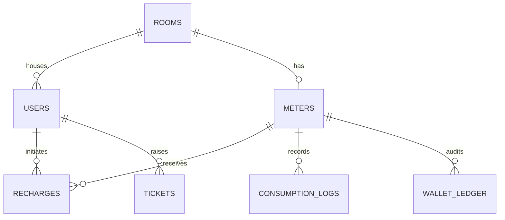

# Data Model Notes

## Entity relationships



- One room has at most one meter in this initial model; `meters.room_id` is unique.
- Each user has one primary room. Users can recharge that room's meter; the service rejects a user-room mismatch.
- `consumption_logs` captures the measured/simulated units, charged cost and post-debit balance for each reading.
- `recharges` stores top-ups and an optional unique idempotency key to reduce accidental duplicate credits.
- `wallet_ledger` is an audit trail: positive `amount` means credit, negative `amount` means consumption debit. `balance_after` makes individual entries easier to reconcile.
- `tickets` tracks support issues independently from wallet transactions.

## Reporting semantics

The `1d` report represents the current UTC calendar day. The `7d` and `30d` reports are rolling windows measured backward from the request time. Daily rows are grouped by the database date of each reading timestamp. A follow-up issue should settle tenant-local timezone behavior before exposing reports across multiple timezones.

## Concurrency and money correctness

PostgreSQL `SELECT ... FOR UPDATE` serializes operations against a meter row. Within a transaction, the service updates the balance and writes the corresponding recharge/consumption and ledger row before commit. PostgreSQL integration tests should be included before claiming race-condition safety under concurrent load. SQLite ignores row-level `FOR UPDATE` and should not be used to test that property.

## Example reporting query (PostgreSQL)

The service uses SQL aggregation for report totals and daily buckets. For ad-hoc seven-day analysis, the equivalent query is:

```sql
SELECT
    DATE(created_at) AS usage_date,
    SUM(units_used) AS total_units,
    SUM(cost) AS total_cost,
    COUNT(*) AS reading_count
FROM consumption_logs
WHERE meter_id = :meter_id
  AND created_at >= CURRENT_TIMESTAMP - INTERVAL '7 days'
GROUP BY DATE(created_at)
ORDER BY usage_date;
```

For the `1d` report, use the current UTC calendar-day boundary instead of the rolling `INTERVAL '7 days'` cutoff. The `30d` report uses `INTERVAL '30 days'`.
